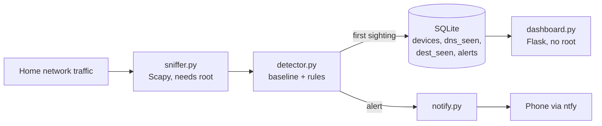

# netwatch

A home network anomaly detector. It watches traffic with Scapy, learns what normal looks like for each device, then alerts your phone when something new happens:

- a device you have never seen joins the network
- a known device looks up a domain it has never looked up
- a known device connects to an outside server that no DNS lookup explains (a hard-coded IP, or a device bypassing your DNS)

Everything is stored in SQLite and shown on a small web dashboard.

## How it works



The sniffer and dashboard are separate processes. Only the sniffer needs root, and SQLite's WAL mode lets both use the database at once.

### The detection model

Everything is "first time seen" logic, keyed per device (by MAC address).

| Rule | Fires when | Severity |
|---|---|---|
| `new_device` | A MAC address appears that is not in the baseline | high |
| `new_domain` | A known device looks up a base domain it has never looked up | medium |
| `unexplained_destination` | A known device opens a connection to an outside IP with no matching DNS answer | high |

How it behaves:

1. **Learning period** (default 72 hours). Everything is recorded silently. Leave it running across a weekday and a weekend so the baseline includes your normal routine.
2. **Alerting.** The first sighting of anything new raises one alert, then joins the baseline. You are never told about the same thing twice.
3. **New-device grace period** (default 24 hours). A device that appears after learning ends is alerted once as a new device, then stays quiet while it builds its own baseline. Otherwise a new phone would fire hundreds of `new_domain` alerts.

Details that keep it quiet:

- Domains are grouped by base domain (`cdn.samsung.com` and `api.samsung.com` are both `samsung.com`; `abc.net.au` is handled correctly).
- Destinations that a DNS answer explains are stored but never alerted on, because `new_domain` already covers them. Only raw-IP connections alert.
- Traffic to other devices on your LAN, multicast and broadcast is ignored.
- Phones and laptops often use a randomised "private" Wi-Fi address. These are flagged in the alert text and on the dashboard, since they are a common source of harmless `new_device` alerts.
- Phone notifications are capped (default 20 per hour). Past the cap, alerts still go to the dashboard.

## Where to run it (read this first)

Scapy only sees the packets that reach the machine it runs on. On a normal switched or Wi-Fi network, a laptop sees its own traffic plus broadcasts, not other devices' DNS or connections.

| Setup | New-device alerts | DNS and server alerts |
|---|---|---|
| Laptop or Pi on Wi-Fi/LAN, no mirroring | Yes (ARP broadcasts) | Own traffic only |
| Pi on a managed-switch mirror (SPAN) port | Yes | Yes |
| Running on the router itself (e.g. OpenWrt) | Yes | Yes |

A cheap managed switch with port mirroring is the usual home solution:

```
 Modem/Router ──► Managed switch ──► Wi-Fi access point ──► phones, TV, laptops
                        │  (mirror port)
                        └────────────► Raspberry Pi running netwatch
```

Put the switch between the router and your access point, so traffic still carries each device's real IP and MAC. If you capture on the router's WAN side, everything looks like one NATed device.

## Setup

```bash
git clone <your repo> && cd netwatch
python3 -m venv .venv && source .venv/bin/activate
pip install -r requirements.txt
sudo apt install tcpdump        # Linux: provides libpcap for the capture filter
```

### Phone notifications (ntfy)

1. Install the **ntfy** app on your phone (iOS or Android).
2. Subscribe to a long random topic name, for example `netwatch-k3j9x2m8q1`. Anyone who knows the topic can read your alerts on the public server, so treat it like a password.
3. Tell netwatch the topic and send a test:

```bash
export NETWATCH_NTFY_TOPIC=netwatch-k3j9x2m8q1
python -m netwatch.sniffer --test-notify
```

To keep alerts off a public server, self-host ntfy and set `NETWATCH_NTFY_URL`.

### Run

```bash
# Terminal 1: capture (root needed). Keep your env vars with -E, and use the venv's python.
sudo -E .venv/bin/python -m netwatch.sniffer -i eth0

# Terminal 2: dashboard
python -m netwatch.dashboard        # http://127.0.0.1:8080
```

For a permanent setup, run both as systemd services. Delete `netwatch.db` or run the sniffer with `--relearn` to restart the learning period.

## Configuration

All settings are environment variables.

| Variable | Default | Meaning |
|---|---|---|
| `NETWATCH_IFACE` | scapy default | Interface to capture on |
| `NETWATCH_DB` | `./netwatch.db` | SQLite file |
| `NETWATCH_LEARNING_HOURS` | 72 | Silent learning period |
| `NETWATCH_NEW_DEVICE_GRACE_HOURS` | 24 | Quiet period for devices that appear later |
| `NETWATCH_NTFY_TOPIC` | empty | Empty turns phone alerts off |
| `NETWATCH_NTFY_URL` | `https://ntfy.sh` | ntfy server |
| `NETWATCH_MAX_NOTIFS_PER_HOUR` | 20 | Phone notification cap |
| `NETWATCH_DASHBOARD_HOST` / `_PORT` | `127.0.0.1` / 8080 | Where the dashboard listens |
| `NETWATCH_DASHBOARD_URL` | empty | Opened when you tap a notification |

## Dashboard

The overview shows learning status, alerts per day for the last week, open alerts you can dismiss, and every device with its last-seen time. Click a device to name it ("Living room TV"), see every domain and server in its baseline, and spot raw-IP connections.

The dashboard has no login. Keep it on `127.0.0.1`, or put it behind a VPN or reverse proxy with authentication before exposing it to your network.

## Database

| Table | Holds |
|---|---|
| `devices` | MAC, IP, label, first/last seen, private-address flag, per-device quiet period |
| `dns_seen` | Baseline of (device, domain) pairs |
| `dest_seen` | Baseline of (device, destination, port) and whether DNS explained it |
| `alerts` | Every alert, with severity and dismissed state |
| `meta` | Learning end time and bookkeeping |

## Tests

```bash
python -m pytest -q
```

The tests replay hand-built packets through the detector (learning silence, one alert per new thing, subdomain grouping, DNS-explained vs raw-IP destinations, ARP discovery, restart persistence). They need no network and no root. The live capture path and ntfy delivery are not covered by tests.

## Limitations

- **Encrypted DNS is invisible.** Devices using DNS-over-HTTPS or DNS-over-TLS skip port 53, so their lookups never appear, and their connections will look like raw-IP destinations. Pointing your router's DHCP at your own resolver and blocking outbound 853 helps.
- **IPv4 only.** IPv6 traffic is not captured.
- **Payloads are not inspected.** It sees who talks to whom, not what is said.
- **Learning can be poisoned.** A device already compromised during the learning period has its bad behaviour baked in as normal. Learn on a network you trust.
- **Raw-IP alerts can be noisy at first.** Apps sometimes reuse DNS answers cached before the sniffer started. If one device keeps tripping this, check its page and decide if it is normal.
- **CDNs.** Grouping by base domain avoids most CDN noise, but a service that moves to a brand-new domain will alert once.

## Ideas for next steps

- Volume spikes per device (bytes per hour against its own average)
- DNS tunnelling detection (many unique subdomains under one base domain)
- Vendor lookup from the MAC prefix (OUI database) to name devices automatically
- Mark a device as "IoT, strict" with a longer learning period and higher alert severity
- IPv6 support

## Layout

```
netwatch/
  config.py      environment-variable settings
  db.py          schema and helpers
  detector.py    baseline and rules (the core)
  sniffer.py     Scapy capture entrypoint
  notify.py      ntfy client with rate limiting
  dashboard.py   Flask app
  templates/     dashboard pages
tests/           packet-replay tests
```
